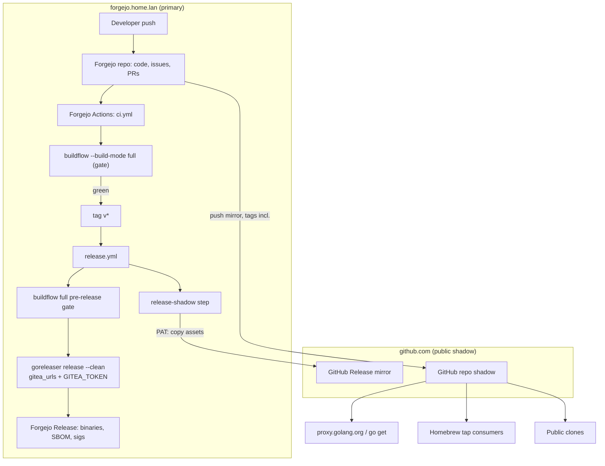
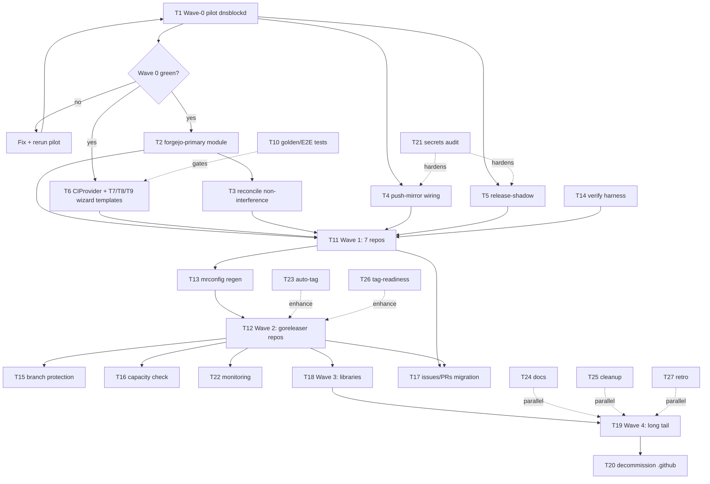

# Master Plan: Forgejo-Primary Fleet Migration (off GitHub as primary)

**Date:** 2026-10-12 15:17
**Status:** PLANNED — awaiting approval to execute
**Scope:** Migrate the LarsArtmann fleet (~265 repos) from GitHub-primary to the self-hosted Forgejo (`forgejo.home.lan`), with BuildFlow as the CI quality gate, GoReleaser releases authored on Forgejo, and GitHub retained as a public push-mirror shadow.
**Sources:** Session exploration (2026-10-12 14:xx), SystemNix `docs/services/forgejo.md` runbook, `platforms/nixos/system/configuration.nix`, BuildFlow workflows, fleet scans via `mr`/`ls`/`grep`. All facts below were verified by command during the session unless marked UNVERIFIED.

---

## 1. Verified ground truth

| Fact                | Value                                                                                                                | Source                                        |
| ------------------- | -------------------------------------------------------------------------------------------------------------------- | --------------------------------------------- |
| Fleet size          | ~265 active repos in `~/.mrconfig` (273 entries, 181 stale-commented)                                                | `mr list`                                     |
| Forgejo             | v15.0.6 at `https://forgejo.home.lan` (LAN-internal, NO public exposure), sqlite, dedicated btrbk-snapshotted subvol | SystemNix runbook                             |
| Mirrors today       | ~470 **pull mirrors** (read-only) of every owned GitHub repo + orgs; hourly reconcile, 2h worst-case staleness       | runbook + configuration.nix                   |
| Runner              | `gitea-runner@evo-x2` (192.168.1.150), label `native`, 16G memory watermark, documented evening memory pressure      | system-health.nix, memory-watermark-audit.nix |
| GoReleaser adoption | 39 repos with `.goreleaser.y(a)ml`                                                                                   | fleet scan                                    |
| Forgejo CI adoption | 7 repos carry `.forgejo/workflows` ("Mirrors .github/workflows/ci.yml. **Kept in sync manually**")                   | fleet scan                                    |
| BuildFlow coverage  | 50+ repos with `.buildflow.yml` (exact count TBD, task 13.1 adjacent)                                                | fleet scan (truncated)                        |
| Local checkouts     | ALL origins point at `git@github.com:LarsArtmann/*`; no insteadOf rewrite to Forgejo                                 | `git config --global`                         |
| Proven on runner    | Nix + Attic available in Actions context (monitor365 `nix-cache.yml`); `actions/cache` usable                        | wireguard-collector/monitor365 workflows      |

## 2. Hard constraints (drive the whole design)

1. **`forgejo.home.lan` is unreachable from the internet.** Public `go get` (proxy.golang.org), Homebrew taps, and public binary downloads must keep resolving via `github.com` URLs. GitHub therefore cannot be dropped — it becomes a push-mirror shadow.
2. **Go module paths are immutable** (proxy + checksum DB). Existing `github.com/LarsArtmann/*` module paths survive only if tags keep landing on GitHub. The push mirror guarantees this.
3. **Pull mirrors are read-only.** Flipping a repo = convert to normal repo + reverse mirror direction. The existing reconcile machinery must learn not to fight flipped repos.
4. **GitHub repos must NOT be archived** — archived repos reject pushes, which would kill the push mirror and starve the module proxy.
5. **Single runner (evo-x2)** with documented memory pressure — gating 265 repos + building 39 release sets needs cache discipline and staged rollout; Hetzner scale-out is the pressure valve.
6. **Tags immutable** (go-release skill): every release mistake is a new version, never a re-tag.

## 3. Target architecture

**Ownership contracts (unchanged from proposal, now final):**

| System                                    | Owns                                                                                           | Explicitly does NOT own     |
| ----------------------------------------- | ---------------------------------------------------------------------------------------------- | --------------------------- |
| Forgejo                                   | Primary hosting, issues/PRs, gating CI, releases, branch protection                            | Packaging logic             |
| BuildFlow                                 | Definition of "clean" (lint/format/test/gomod/nix), findings gate, result cache                | Releasing                   |
| GoReleaser                                | Packaging: binaries, SBOM, cosign, checksums, archives                                         | Quality checks              |
| SystemNix (`forgejo-primary` module, new) | Declarative flip list, push-mirror mgmt, reconcile coexistence, release-shadow                 | Per-repo file content       |
| GoReleaser-Wizard                         | Fleet generator: `.goreleaser.yaml` (gitea_urls), forgejo `ci.yml`/`release.yml`, `mr` rollout | Runtime behavior            |
| GitHub                                    | Public shadow: module-path resolution, tap reach, public release assets                        | Source of truth, CI, issues |

---

## 4. Pareto breakdown

### The 1% that delivers 51% — **ONE pilot flip, end-to-end**

A single repo (dnsblockd: small, Go binary, already declaratively mirrored once in SystemNix history) taken through the ENTIRE loop: mirror→normal flip, origin rewrite, push-mirror to GitHub, BuildFlow-gated Forgejo CI, GoReleaser release to Forgejo, release-shadow to GitHub, external verification (`go get` via public proxy, public clone, artifacts). If Wave 0 is green, the pattern is proven and everything else is industrialization + repetition. **Nothing else matters until this is green.**

### The 4% that delivers 64% — **the two automation artifacts**

1. SystemNix `forgejo-primary` module + flip script + reconcile non-interference (makes repetition safe at infra level).
2. Wizard Forgejo templates (`ci.yml`, `release.yml`, gitea_urls goreleaser section, `CIProvider` domain type) + golden/E2E tests (makes repetition cheap at repo level).
   These convert a 60-minute risky manual flip into a 5-minute verified one.

### The 20% that delivers 80% — **flip everything that releases**

Waves 1+2: the 7 Forgejo-CI repos (kill "kept in sync manually") and all 39 GoReleaser repos (binaries first, libraries excluded). After this, every releasing project in the fleet is Forgejo-primary and gated by BuildFlow.

### The other 20% to reach 100% — **libraries, long tail, hardening, hygiene**

Wave 3 (Go libraries, module-path-sensitive, proxy-verified per repo), Wave 4 (non-Go/docs repos), branch protection, monitoring (push-mirror staleness, release-shadow success), secrets audit/rotation, runner capacity decision (Hetzner), issues/PRs migration, auto-tag, tag-readiness fleet, decommission of redundant `.github/workflows`, docs/AGENTS contract updates, cleanup backlog (stale mr entries, BuildFlow repo-root junk, unpinned golangci-lint), retro.

---

## 5. Comprehensive plan — medium granularity (30–100 min each)

Sorted by importance → impact → customer value (customer = fleet owner + public module/binary consumers). Effort in minutes. **Total ≈ 29 h.**

| #   | Task                                                                                                                                                                               | Wave/Phase | Impact | Effort | Delivers                           |
| --- | ---------------------------------------------------------------------------------------------------------------------------------------------------------------------------------- | ---------- | ------ | ------ | ---------------------------------- |
| T1  | Wave-0 pilot: flip dnsblockd end-to-end (flip, push-mirror, BuildFlow CI gate, GoReleaser→Forgejo release, release-shadow, external verify)                                        | P0         | 10     | 100    | Proven pattern; go/no-go for fleet |
| T2  | SystemNix `forgejo-primary` module: declarative `repos` list, flip script v1 (create normal repo, push refs, delete mirror, rewrite origins), dry-run, NixOS test, runbook section | P1         | 9.5    | 90     | Safe repeatable flips              |
| T7  | Wizard: forgejo `ci.yml` template (pinned-nix buildflow bootstrap, `--build-mode full`, result-cache restore, telemetry off) + generator + golden test                             | P1         | 9      | 60     | Fleet CI shape                     |
| T8  | Wizard: forgejo `release.yml` template (buildflow gate → goreleaser gitea_urls/GITEA_TOKEN → release-shadow post-step) + golden test                                               | P1         | 9      | 60     | Fleet release shape                |
| T3  | SystemNix reconcile non-interference: flipped-registry skip (never recreate pull mirror) + push-mirror reconciliation                                                              | P1         | 8.5    | 60     | Automation won't fight flips       |
| T4  | Push-mirror wiring: scoped GitHub PAT, sops secret, Forgejo credential config, sync-on-push latency check                                                                          | P1         | 8.5    | 45     | Module paths stay alive            |
| T9  | Wizard: `.goreleaser.yaml` template gains `gitea_urls` section + token env documentation + golden update                                                                           | P1         | 8      | 30     | Correct release target             |
| T6  | Wizard domain: `CIProvider` enum (github/forgejo/dual/none) in `SafeProjectConfig`, validation, config plumbing, tests                                                             | P1         | 8      | 60     | Typed generator input              |
| T5  | release-shadow service: copy Forgejo release assets→GitHub release (idempotent, checksums, unit tests) + wire as release post-step                                                 | P1         | 8      | 90     | Public artifact availability       |
| T14 | External verification harness: public clone, GOPROXY `go get`, GitHub release assets, wired post-flip + nightly                                                                    | P1         | 7.5    | 60     | Regression tripwire                |
| T11 | Wave 1: flip the 7 Forgejo-CI repos, replace manually-synced workflows with generated ones, remove sync comments                                                                   | P2         | 7.5    | 100    | Split brain dead                   |
| T13 | mrconfig regeneration: teach sync tooling flipped origins, mass rewrite, fleet `mr status` green                                                                                   | P2         | 7      | 45     | Developer workflow intact          |
| T12 | Wave 2: flip remaining GoReleaser repos (classify binary vs lib first; batches of 5–10; wizard regen; spot-verify 3 releases)                                                      | P2         | 7      | 100    | All releasers migrated             |
| T15 | Branch protection on Forgejo for flipped repos: required status checks (CI becomes gating), scripted apply                                                                         | P2         | 6.5    | 45     | CI actually gates                  |
| T10 | Wizard golden tests + actionlint E2E for new templates; dual-provider edge case                                                                                                    | P2         | 6.5    | 90     | Generator correctness              |
| T16 | Runner capacity: cache restore in CI template, path filters, measure pilot duration/memory on evo-x2, Hetzner-runner decision memo                                                 | P2         | 6      | 90     | CI stays fast/stable               |
| T21 | Secrets audit: minimal PAT scopes (push-mirror, release-shadow), rotation policy, sops entries documented                                                                          | P2         | 6      | 45     | Attack surface bounded             |
| T22 | Monitoring: system-health push-mirror staleness per flipped repo, release-shadow success metric, Gatus cards                                                                       | P2         | 6      | 60     | Silent failures impossible         |
| T18 | Wave 3: flip Go libraries in batches + per-repo proxy verification + GOPRIVATE internal consumers check                                                                            | P3         | 5.5    | 100    | Module ecosystem safe              |
| T17 | Issues/PRs migration: inventory open items, trial Forgejo migrate-API import on pilot, decide historical vs fresh                                                                  | P3         | 5      | 60     | No lost work                       |
| T19 | Wave 4: classify + flip long-tail repos (non-Go, docs, tools)                                                                                                                      | P3         | 4.5    | 100    | Fleet fully home                   |
| T24 | Docs: architecture doc + diagram, AGENTS.md CI contract for flipped repos, BuildFlow skill "still owns" note                                                                       | P3         | 4      | 45     | Future sessions informed           |
| T20 | Decommission redundant `.github/workflows` in flipped repos after 2-week green-shadow window                                                                                       | P4         | 4      | 60     | No drift residue                   |
| T23 | Auto-tag forgejo template (version source: CHANGELOG `## [X.Y.Z]`), pilot on one repo                                                                                              | P4         | 3.5    | 60     | Push-button releases               |
| T26 | Nightly tag-readiness job for releasing repos (generalize BuildFlow pattern)                                                                                                       | P4         | 3.5    | 60     | Release drift caught               |
| T25 | Cleanup backlog: 3 stale mr entries, BuildFlow repo-root junk (result*, audit logs) + gitignore, pin golangci-lint in BuildFlow ci.yml                                             | P4         | 3      | 30     | Hygiene debt paid                  |
| T27 | Retro: `buildflow doctor` on runner, gotchas→AGENTS.md, final report                                                                                                               | P4         | 3      | 45     | Loop closed                        |

---

## 6. Fine breakdown — max 12 min each

Sorted by parent priority, then execution order. **Total ≈ 117 tasks ≈ 19.5 h of atomic work** (overlaps with medium estimate: parallelizable batches counted once).

### T1 — Wave-0 pilot (P0)

| ID   | Task                                                                                                         | Effort |
| ---- | ------------------------------------------------------------------------------------------------------------ | ------ |
| 1.1  | Snapshot pre-state: GitHub repo, tags, releases, mrconfig entry of dnsblockd                                 | 5      |
| 1.2  | Create normal (non-mirror) Forgejo repo `LarsArtmann/dnsblockd` via API                                      | 5      |
| 1.3  | Push all refs + tags from local clone to Forgejo                                                             | 10     |
| 1.4  | Delete old read-only pull mirror (after verifying refs landed)                                               | 8      |
| 1.5  | Configure push mirror Forgejo→GitHub (deploy creds), verify sync-on-push                                     | 12     |
| 1.6  | Flip local `origin` + `~/.mrconfig` entry for dnsblockd                                                      | 5      |
| 1.7  | Write minimal `.forgejo/workflows/ci.yml` (buildflow bootstrap + full) on branch; verify green run on evo-x2 | 12     |
| 1.8  | Add `gitea_urls` section to dnsblockd `.goreleaser.yaml`                                                     | 8      |
| 1.9  | `goreleaser release --snapshot` on runner (UNVERIFIED claim to prove: goreleaser↔Forgejo v15 API compat)     | 12     |
| 1.10 | Tag `vNext` → full release → verify Forgejo release page + assets                                            | 12     |
| 1.11 | Manual release-shadow run → GitHub release assets appear on mirror repo                                      | 12     |
| 1.12 | External verify: `GOPROXY=proxy.golang.org go get`, public clone, asset URLs                                 | 10     |
| 1.13 | Document gotchas in SystemNix `docs/services/forgejo.md` runbook                                             | 12     |

### T2 — `forgejo-primary` module (P1)

| ID  | Task                                                                       | Effort |
| --- | -------------------------------------------------------------------------- | ------ |
| 2.1 | Read `forgejo.nix` + collapsed `forgejo-repos` module patterns             | 10     |
| 2.2 | Design option schema: `repos = [ { name, pushMirror, shadow } ]`           | 12     |
| 2.3 | Implement module skeleton + config rendering                               | 12     |
| 2.4 | Flip script v1: normal-repo create + ref push + mirror delete (API-driven) | 12     |
| 2.5 | Flip script: origin/mrconfig rewrite helpers                               | 10     |
| 2.6 | Dry-run mode + structured logging                                          | 10     |
| 2.7 | NixOS test: module evaluates, units/scripts generated                      | 12     |
| 2.8 | Runbook section: flip procedure + rollback                                 | 12     |

### T7 — Wizard forgejo ci.yml (P1)

| ID  | Task                                                                                                                | Effort |
| --- | ------------------------------------------------------------------------------------------------------------------- | ------ |
| 7.1 | Read `templates/embedded.go` embed mechanism (resolve session's open grep miss)                                     | 8      |
| 7.2 | Template data struct: runner label, buildflow pin (rev), cache toggle                                               | 12     |
| 7.3 | Author `ci.yml` template: checkout → pinned `nix profile install` → `buildflow --build-mode full` → `actions/cache` | 12     |
| 7.4 | Generator wiring: `shouldGenerate()` for forgejo provider, rollback path                                            | 12     |
| 7.5 | Golden test for rendered ci.yml                                                                                     | 12     |

### T8 — Wizard forgejo release.yml (P1)

| ID  | Task                                                                        | Effort |
| --- | --------------------------------------------------------------------------- | ------ |
| 8.1 | Author `release.yml` template: gate → goreleaser → release-shadow post-step | 12     |
| 8.2 | Generator + rollback wiring                                                 | 12     |
| 8.3 | Golden test                                                                 | 12     |

### T3 — Reconcile non-interference (P1)

| ID  | Task                                                         | Effort |
| --- | ------------------------------------------------------------ | ------ |
| 3.1 | Read reconcile script namespace/pair classification          | 10     |
| 3.2 | Flipped-registry input: read `forgejo-primary` state         | 12     |
| 3.3 | Skip logic: flipped repos never pull-mirror-recreated        | 12     |
| 3.4 | Push-mirror reconciliation: ensure exists + interval + creds | 12     |
| 3.5 | Dev test against pilot repo state                            | 12     |

### T4 — Push-mirror wiring (P1)

| ID  | Task                                                                   | Effort |
| --- | ---------------------------------------------------------------------- | ------ |
| 4.1 | Create scoped GitHub PAT (repo contents+releases only) for machine use | 10     |
| 4.2 | sops secret entry + Forgejo push-mirror credential wiring              | 10     |
| 4.3 | Measure sync-on-push latency (push commit → visible on GitHub)         | 8      |

### T9 — goreleaser gitea_urls (P1)

| ID  | Task                                                                          | Effort |
| --- | ----------------------------------------------------------------------------- | ------ |
| 9.1 | Add `gitea_urls` (api/upload) to goreleaser template + `GITEA_TOKEN` env docs | 10     |
| 9.2 | Update golden files                                                           | 8      |

### T6 — Wizard `CIProvider` domain type (P1)

| ID  | Task                                              | Effort |
| --- | ------------------------------------------------- | ------ |
| 6.1 | Read `SafeProjectConfig` + existing enum patterns | 10     |
| 6.2 | `CIProvider` type + constants + `IsValid()`       | 12     |
| 6.3 | Config field, YAML plumbing, defaults             | 12     |
| 6.4 | Validation rules + table tests                    | 12     |

### T5 — release-shadow service (P1)

| ID  | Task                                                         | Effort |
| --- | ------------------------------------------------------------ | ------ |
| 5.1 | Design: trigger (release post-step vs timer), failure policy | 10     |
| 5.2 | Implement Forgejo→GitHub release asset copy (both APIs)      | 12     |
| 5.3 | Idempotency: skip-existing, checksum verify                  | 12     |
| 5.4 | Unit tests with API fixtures                                 | 12     |
| 5.5 | Wire as post-step in release.yml template                    | 8      |
| 5.6 | Monitoring hook (metric + Gatus)                             | 8      |

### T14 — Verification harness (P1)

| ID   | Task                                        | Effort |
| ---- | ------------------------------------------- | ------ |
| 14.1 | Script: public clone check per repo         | 6      |
| 14.2 | Script: `GOPROXY` `go get` check per module | 10     |
| 14.3 | Script: GitHub release assets present       | 8      |
| 14.4 | Wire post-flip + nightly Forgejo job        | 10     |

### T11 — Wave 1: 7 repos (P2)

| ID   | Task                                                                               | Effort |
| ---- | ---------------------------------------------------------------------------------- | ------ |
| 11.1 | Flip collector-utils + regen workflows                                             | 12     |
| 11.2 | Flip wireguard-collector + regen workflows                                         | 12     |
| 11.3 | Flip monitor365 (+ nix-cache job stays)                                            | 12     |
| 11.4 | Flip crm                                                                           | 12     |
| 11.5 | Flip crm-exec-stage                                                                | 12     |
| 11.6 | Flip eventcatalog-hub                                                              | 12     |
| 11.7 | Flip sperrmuell-direct                                                             | 12     |
| 11.8 | Remove "kept in sync manually" comments + retire `.github` CI copies (after green) | 12     |
| 11.9 | Wave-1 retro: what broke, feed runbook                                             | 10     |

### T13 — mrconfig regen (P2)

| ID   | Task                                                         | Effort |
| ---- | ------------------------------------------------------------ | ------ |
| 13.1 | Find mrconfig sync tooling (pma ecosystem) + read generation | 10     |
| 13.2 | Teach it flipped origins / mass rewrite entries              | 12     |
| 13.3 | Fleet `mr status` green check                                | 10     |

### T12 — Wave 2: goreleaser repos (P2)

| ID   | Task                                                              | Effort |
| ---- | ----------------------------------------------------------------- | ------ |
| 12.1 | Classify all 39: binary vs library (libraries deferred to Wave 3) | 8      |
| 12.2 | Batch flip binaries, pass 1 (5–10 repos)                          | 12     |
| 12.3 | Batch flip binaries, pass 2                                       | 12     |
| 12.4 | Batch flip binaries, pass 3                                       | 12     |
| 12.5 | Batch flip binaries, pass 4 (remainder)                           | 12     |
| 12.6 | Wizard regen configs, batch A                                     | 12     |
| 12.7 | Wizard regen configs, batch B                                     | 12     |
| 12.8 | Spot-verify full releases on 3 repos                              | 12     |

### T15 — Branch protection (P2)

| ID   | Task                                                | Effort |
| ---- | --------------------------------------------------- | ------ |
| 15.1 | Forgejo API: required status checks config per repo | 12     |
| 15.2 | Script + apply to all flipped repos                 | 12     |

### T10 — Wizard tests/E2E (P2)

| ID   | Task                                                        | Effort |
| ---- | ----------------------------------------------------------- | ------ |
| 10.1 | actionlint validation of generated workflows in E2E         | 12     |
| 10.2 | E2E: generate → goreleaser check + actionlint both green    | 12     |
| 10.3 | Edge: dual provider renders both workflow sets consistently | 10     |

### T16 — Capacity (P2)

| ID   | Task                                                             | Effort |
| ---- | ---------------------------------------------------------------- | ------ |
| 16.1 | Add `actions/cache` (buildflow cache+state paths) to ci template | 12     |
| 16.2 | Measure pilot CI duration + memory on evo-x2                     | 10     |
| 16.3 | Path filters (docs/markdown ignore) in template                  | 8      |
| 16.4 | Decision memo: Hetzner runner now/later/never                    | 10     |

### T21 — Secrets audit (P2)

| ID   | Task                                                         | Effort |
| ---- | ------------------------------------------------------------ | ------ |
| 21.1 | Enumerate minimal PAT scopes; verify no broad classic tokens | 10     |
| 21.2 | Rotation policy + sops entries documented                    | 10     |

### T22 — Monitoring (P2)

| ID   | Task                                                  | Effort |
| ---- | ----------------------------------------------------- | ------ |
| 22.1 | system-health: per-flipped-repo push-mirror staleness | 12     |
| 22.2 | release-shadow success metric + Gatus card            | 12     |

### T18 — Wave 3: libraries (P3)

| ID   | Task                                               | Effort |
| ---- | -------------------------------------------------- | ------ |
| 18.1 | List Go libraries + internal consumers (GOPRIVATE) | 8      |
| 18.2 | Flip batch 1 + proxy verification each             | 12     |
| 18.3 | Flip batch 2 + proxy verification each             | 12     |
| 18.4 | Flip batch 3 + proxy verification each             | 12     |

### T17 — Issues/PRs (P3)

| ID   | Task                                                         | Effort |
| ---- | ------------------------------------------------------------ | ------ |
| 17.1 | Inventory open issues/PRs across flipping repos              | 10     |
| 17.2 | Trial migrate-API import on pilot                            | 12     |
| 17.3 | Decision: historical import vs fresh-start, record rationale | 8      |

### T19 — Wave 4: long tail (P3)

| ID   | Task                                                 | Effort |
| ---- | ---------------------------------------------------- | ------ |
| 19.1 | Classify remaining repos (non-Go, docs, experiments) | 5      |
| 19.2 | Batch flip long-tail pass 1                          | 12     |
| 19.3 | Batch flip long-tail pass 2                          | 12     |

### T24 — Docs (P3)

| ID   | Task                                                              | Effort |
| ---- | ----------------------------------------------------------------- | ------ |
| 24.1 | Fleet architecture doc + diagram (this plan → permanent home)     | 12     |
| 24.2 | AGENTS.md CI contract snippet for flipped repos                   | 10     |
| 24.3 | BuildFlow skill "still owns" table update (forgejo CI delegation) | 8      |

### T20 — Decommission .github workflows (P4)

| ID   | Task                                              | Effort |
| ---- | ------------------------------------------------- | ------ |
| 20.1 | Define 2-week green-shadow window policy per repo | 5      |
| 20.2 | Remove redundant workflows, batch A               | 12     |
| 20.3 | Remove redundant workflows, batch B               | 12     |

### T23 — Auto-tag (P4)

| ID   | Task                                                  | Effort |
| ---- | ----------------------------------------------------- | ------ |
| 23.1 | Decide version source (CHANGELOG heading recommended) | 10     |
| 23.2 | Wizard auto-tag forgejo template                      | 12     |
| 23.3 | Pilot on one releasing repo                           | 12     |

### T26 — Tag-readiness fleet (P4)

| ID   | Task                                     | Effort |
| ---- | ---------------------------------------- | ------ |
| 26.1 | Nightly job template for releasing repos | 12     |
| 26.2 | Apply to Wave-2 repos                    | 10     |

### T25 — Cleanup backlog (P4)

| ID   | Task                                                                            | Effort |
| ---- | ------------------------------------------------------------------------------- | ------ |
| 25.1 | Fix 3 stale mr entries (Castle/, bewerbungen/, hierarchical-errors/)            | 8      |
| 25.2 | Trash BuildFlow repo-root junk (result*, workflow-audit-log-*.html) + gitignore | 8      |
| 25.3 | Pin golangci-lint version in BuildFlow ci.yml                                   | 10     |

### T27 — Retro (P4)

| ID   | Task                                         | Effort |
| ---- | -------------------------------------------- | ------ |
| 27.1 | `buildflow doctor` on evo-x2 runner          | 8      |
| 27.2 | Gotchas → AGENTS.md + final migration report | 12     |

---

## 7. Execution graph

## 8. Verschlimmbessern guardrails (point 5 acknowledged)

1. **No bulk operation before the pilot is green.** Waves never start while Wave 0 has an open question.
2. **Pull mirrors are only deleted after refs are verified on the new normal repo.** Mirror content is re-derivable from GitHub, but verify anyway.
3. **GitHub repos are never archived, never deleted** (module-proxy lifeline).
4. **The reconcile machinery gets the flipped-registry skip BEFORE Wave 1** — otherwise hourly runs fight the migration.
5. **Every wave is batched (5–10 repos) with the verification harness green between batches.** No "flip all 265 in one go".
6. **Tags immutable; broken release = new version.** (go-release skill)
7. **Rollback path per wave:** flipped repos can push back to GitHub-primary by re-adding origin; nothing destroys data that isn't re-derivable.
8. **Generated workflow files carry a "generated by GoReleaser-Wizard vX" header; hand-edits get overwritten on regen by design — loudly documented.**

## 9. Verification gates (definition of green)

- **Gate 0 (pilot):** CI green on Forgejo runner; Forgejo release exists with assets; GitHub release shadow identical; `GOPROXY=proxy.golang.org go get github.com/LarsArtmann/dnsblockd@vNext` succeeds from an external network; public clone works.
- **Gate per wave batch:** flip script exit 0; `mr status` clean; verification harness green for all repos in batch; reconcile log shows zero conflicts for flipped repos.
- **Gate final:** all 265 repos Forgejo-primary; nightly harness green for a full week; BuildFlow gate required-status-check enforced on all releasing repos.

## 10. Open questions (cannot resolve alone)

1. Issues/PRs: historical import (Forgejo migrate API) or fresh-start? (T17)
2. Public Forgejo hostname ever (via Hetzner reverse proxy) so future modules can leave `github.com` paths — or is LAN-only permanent by design?
3. dnsblockd as Wave-0 pilot — approved, or prefer a different repo?

---

_Plan author: Crush session 2026-10-12. Consumes: status report `2026-10-12_14-19`. Feeds: TODO_LIST.md harvest on approval._
