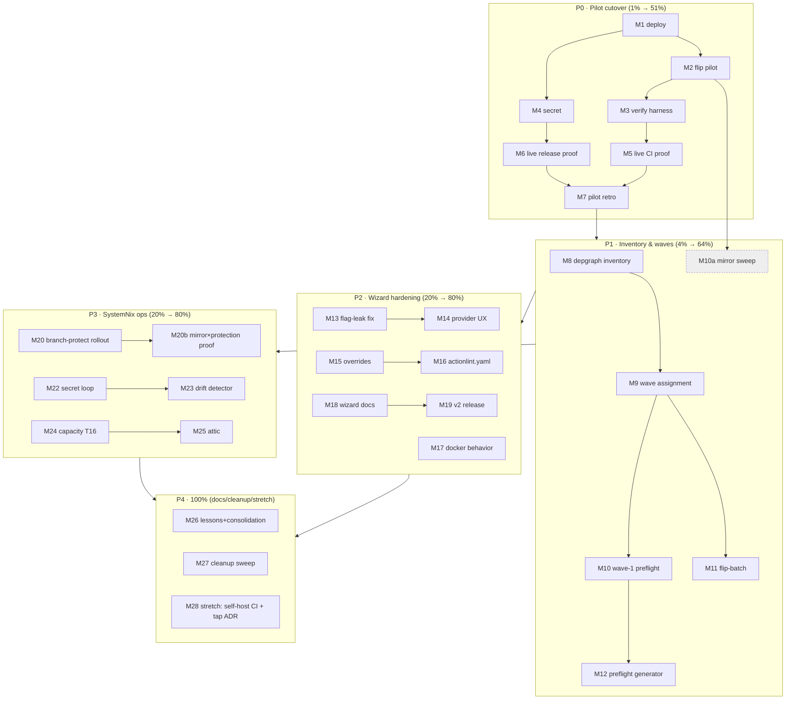

# SUPERB: Forgejo Fleet Cutover — Pareto Execution Plan

**Created**: 2026-11-03 17:05
**Author**: Crush session (pareto-planning skill)
**Input backlog**: `docs/status/2026-10-28_02-35_forgejo-migration-full-status-a-g.md` §f (50 items) + §b partials + privileged batch Phases A–E
**Master plan**: `docs/planning/2026-10-12_15-17_forgejo-primary-migration-master-plan.md`
**User-run batch**: `docs/planning/forgejo-migration-privileged-batch.md`
**New tooling adopted this session**: `project-dependency-graph` (`~/projects/project-dependency-graph`) — fleet inventory (`--dir ~/projects`), activity/coupling queries (`who-uses`, `update-plan`, `release-suggestions`), Mermaid/D2 graph export. It becomes the authoritative wave-assignment input instead of a hand-rolled sweep.

---

## 0. State of the world (verified 2026-11-03)

- Wizard T6–T10 (Forgejo CI provider), dnsblockd pilot content, SystemNix release-shadow + branch-protect: **shipped and green** (2026-10-28 sessions, commits `9334dc3`, `411dce43`, `a5a28f72`, `80989034`).
- A follow-up session (2026-10-28 10:10) landed Go 1.27 toolchain alignment + quality-gate repair; `nix flake check` green there; `nix test` 6/6 green now.
- **Unknown**: whether the owner ran privileged Phases A–B (deploy + dnsblockd flip) since 10-28. Every flip/deploy command is idempotent or refuses loudly, so re-running the check phase is safe; blind re-execution of the flip is prevented by its own guards (refuses non-mirrors).
- Mirror-Actions question answered 10-28 (mirrors have `has_actions:false`; flip arms workflows).

## 1. Pareto breakdown

### 1% — ~51% of the result
**The dnsblockd pilot cutover loop, made verifiable.** One repo flipped + CI proven + release proven end-to-end on the real runner proves (or falsifies) the ENTIRE migration design: templates, pins, runner labels, shadow, secret wiring. Everything else in the backlog is speculation until this exists. Concretely: owner runs batch Phases A–B, agent provides the verification harness, then live CI + release proofs (M1–M5).

### 4% — ~64% of the result
1% **plus**: pilot retro folded into the master plan, the `depgraph` fleet inventory that turns ~265 unknown repos into 4 concrete wave lists, and the authenticated `has_actions` confirmation. After this, waves are mechanical.

### 20% — ~80% of the result
4% **plus** wizard hardening (flag-leak fix, provider-aware UX, owner/runner overrides, generated actionlint config, docs, v2 release) and the SystemNix ops loop (branch-protect rollout verification, secret provisioning automation, shadow drift detector). This makes the migration *repeatable* and observable instead of a one-off.

### Remaining 20% → 100%
Capacity measurement + cache decisions, attic integration, non-wizard repo seeding (Rust/JS), lessons/runbook consolidation, cleanup sweep, stretch items (self-hosted wizard CI, tap policy). Valuable but none block a single flip.

## 2. Comprehensive plan — medium tasks (30–100 min each, ALL todos, sorted by impact)

| # | Task | Min | Owner | Impact | Effort | Covers (fine IDs) |
|---|------|----:|-------|--------|--------|-------------------|
| M1 | **Privileged Phase A deploy** (SystemNix switch: canonicalRepos, release-shadow, branch-protect, ssh-keys fix) + verify `ssh -T`, binaries on PATH | 60 | owner | ★★★ | low | F1–F4 |
| M2 | **Privileged Phase B flip pilot** (`forgejo-flip-check@dnsblockd` → read plan → `forgejo-flip@dnsblockd` → sync-unit phase 5 attaches push mirror) | 60 | owner | ★★★ | low | F5–F8 |
| M3 | **Post-flip verification harness** (agent script: repo API mirror=false, has_actions=true PATCH if needed, workflows present, push mirror attached, branch protected) | 60 | agent | ★★★ | med | F9–F14 |
| M4 | **Phase C secret provisioning** on dnsblockd (`RELEASE_SHADOW_GITHUB_TOKEN`; policy per question g2) | 45 | owner | ★★★ | low | F15–F17 |
| M5 | **Live CI proof**: push commit to dnsblockd, watch `native` runner execute BuildFlow gate; fix any act_runner quirks in templates | 90 | agent+owner | ★★★ | med | F18–F23 |
| M6 | **Live release proof**: tag v0.9.5 on Forgejo → BuildFlow gate → goreleaser (`GITEA_TOKEN`) → shadow copies assets to GitHub → verify both release pages | 90 | agent+owner | ★★★ | med | F24–F30 |
| M7 | **Pilot retro + plan update**: master plan §6 annotations, batch doc Phase F skeleton, mirror-Actions positive-control record | 60 | agent | ★★ | low | F31–F35 |
| M8 | **depgraph fleet inventory**: run over `~/projects`, JSON + Mermaid export, language/build-system metadata for every repo | 45 | agent | ★★★ | low | F36–F40 |
| M9 | **Wave assignment**: derive wave 1–4 lists from inventory (activity × release cadence × language); write into batch doc Phase F | 60 | agent | ★★★ | med | F41–F45 |
| M10 | **Authenticated mirror sweep**: confirm `has_actions:false` on private mirrors (dnsblockd-pre-flip if still mirror, monitor365, wireguard-collector) | 30 | agent | ★★ | low | F46–F48 |
| M11 | **`forgejo-flip-batch@` design + implement** (SystemNix unit: name list → sequential flips, stop-on-first-failure, dry-run twin) | 100 | agent | ★★ | high | F49–F56 |
| M12 | **Wave 1 preflight generator** (per-repo checklist: forgejo files present, issues/PR counts, starred/pending-verdict gates) | 60 | agent | ★★ | med | F57–F61 |
| M13 | **Fix `-update-golden` flag leak** (scrub `os.Args` for CLI-harness tests; prove update mode green end-to-end) | 45 | agent | ★★ | low | F62–F65 |
| M14 | **Provider-aware CLI output** (success tips reference `.forgejo/workflows` for forgejo/dual; next-step hints) | 45 | agent | ★★ | low | F66–F69 |
| M15 | **`--forgejo-owner` + `--runner-label` overrides** (template data + flags + tests; org-owned repos need this) | 90 | agent | ★★ | med | F70–F75 |
| M16 | **Wizard generates `.forgejo/actionlint.yaml`** (native label) for forgejo/dual providers + golden + tests | 60 | agent | ★★ | med | F76–F80 |
| M17 | **Docker-missing CLI behavior** (decision from question g3, then implement: fail/warn/skip) | 60 | agent | ★ | med | F81–F84 |
| M18 | **Wizard docs for the flag**: README section, FEATURES entries, DOMAIN_LANGUAGE vocabulary (CIProvider, primary/shadow) | 60 | agent | ★★ | low | F85–F90 |
| M19 | **Branch-protect rollout verification** across all 6 canonicalRepos entries after first phase-6 run (incl. policy answer g1) | 45 | agent | ★★ | low | F91–F94 |
| M20 | **Push-mirror × branch-protection interplay proof** (mirror commits still land post-protection; document in runbook) | 60 | agent+owner | ★★ | med | F95–F98 |
| M21 | **Secret provisioning loop** (script: N repos × PUT actions secret; admin-token gated, owner-run) | 60 | agent+owner | ★★ | med | F99–F102 |
| M22 | **Shadow drift detector** (host-side Gatus check: Forgejo latest release tag == GitHub twin's) | 90 | agent | ★★ | med | F103–F107 |
| M23 | **Runner capacity measurement** (T16: pilot CI wall-time, concurrency, memory; capacity 2→N decision; actions/cache verdict) | 90 | agent | ★★ | med | F108–F112 |
| M24 | **Attic cache integration** in forgejo workflow templates (monitor365 pattern) | 60 | agent | ★ | med | F113–F116 |
| M25 | **Lessons + docs consolidation** (lessons.md candidates, SystemNix runbook mirror-Actions note, goreleaser `use: gitea` verification) | 45 | agent | ★ | low | F117–F121 |
| M26 | **Cleanup sweep** (dead `OrEmpty` check, SystemNix `io-writer-attribution.sh` verdict, dnsblockd status README daemon change, forgejo workflows dir perms) | 60 | agent | ★ | low | F122–F127 |
| M27 | **Stretch**: wizard self-hosts CI on forgejo (eats own dogfood) + Homebrew tap implications ADR | 90 | agent | ★ | med | F128–F132 |

Total medium: 27 tasks ≈ 26.5 h; owner-gated work ≈ 2.5 h of it (M1, M2, M4 + slices of M5/M6/M20/M21).

## 3. Detailed breakdown — fine tasks (≤12 min each, ALL todos, sorted by impact)

| # | Task | Min | Task |
|---|------|----:|------|
| F1 | Check `git -C ~/projects/SystemNix status` clean, `nix flake check` green | 10 |
| F2 | `sudo nixos-rebuild switch --flake .#evo-x2` (Phase A) | 12 |
| F3 | Verify `ssh -T git@forgejo.home.lan` greets (ssh-keys service re-ran) | 5 |
| F4 | Verify `forgejo-release-shadow` + `forgejo-branch-protect` on PATH | 5 |
| F5 | `forgejo-flip-check@dnsblockd` dry-run, read plan output | 10 |
| F6 | `forgejo-flip@dnsblockd` execute | 12 |
| F7 | Read flip journal: import counts (issues/PRs/releases) plausible | 8 |
| F8 | Trigger/wait sync-unit phase 5 → "push mirror attached" for dnsblockd | 10 |
| F9 | Write `scripts/forgejo-post-flip-verify.sh` (repo API + workflows + push mirror + protection checks) in SystemNix | 12 |
| F10 | Wire verify script args (owner, repo, token env) + dry-run mode | 10 |
| F11 | Run harness against dnsblockd; expect all-green | 8 |
| F12 | PATCH `has_actions:true` if flip left it false (admin token, root) | 8 |
| F13 | Fixture/CI-proof the verify script (stub curl harness like existing fixtures) | 12 |
| F14 | Commit harness to SystemNix with detailed message | 5 |
| F15 | Owner: decide PAT policy (question g2: reuse sync PAT vs dedicated) | 5 |
| F16 | PUT `RELEASE_SHADOW_GITHUB_TOKEN` secret on dnsblockd (Phase C) | 8 |
| F17 | List secrets API → confirm stored | 5 |
| F18 | `git push origin master` (or forgejo remote) to trigger CI | 5 |
| F19 | Watch run in Forgejo UI / API: checkout → nix install BuildFlow | 12 |
| F20 | Observe `buildflow --build-mode full` result on runner | 12 |
| F21 | Capture act_runner quirks (PATH, GITHUB_PATH support, nix availability) | 10 |
| F22 | Fix template issues found (wizard templates + regenerate dnsblockd files) | 12 |
| F23 | Green CI run recorded in master plan §6 | 5 |
| F24 | Cut tag `v0.9.5` on dnsblockd, push to Forgejo remote | 8 |
| F25 | Watch release workflow: BuildFlow gate green | 10 |
| F26 | Watch goreleaser step: `GITEA_TOKEN` release created on Forgejo | 10 |
| F27 | Watch shadow step: assets copied to GitHub twin | 10 |
| F28 | Verify GitHub release page (assets count == Forgejo) | 8 |
| F29 | Verify proxy.golang.org / clone path unaffected | 8 |
| F30 | Record release timings (feeds M23 capacity data) | 5 |
| F31 | Annotate master plan T1/T5/T22/T6–T10 statuses | 10 |
| F32 | Batch doc: add Phase F skeleton (wave 1 command block) | 10 |
| F33 | Batch doc: record pilot evidence links (run URLs, release URLs) | 8 |
| F34 | Update mirror-Actions answer with positive-control result | 5 |
| F35 | Commit + push docs (wizard + SystemNix + dnsblockd as touched) | 10 |
| F36 | `cd ~/projects/project-dependency-graph && go build -o depgraph .` | 8 |
| F37 | `depgraph --dir ~/projects --format json > /tmp/fleet.json` | 8 |
| F38 | Sanitize inventory: name, language, build system, last-commit age | 12 |
| F39 | Export Mermaid graph of own-projects coupling | 8 |
| F40 | Cross-check inventory vs `mr list` count (~265 expected) | 10 |
| F41 | Define wave scoring: activity (commits/90d) × release cadence × language risk | 10 |
| F42 | Assign wave 1 (5–10 active Go CLIs, incl. any the wizard dogfoods on) | 10 |
| F43 | Assign wave 2 (actively developed Go libraries) | 8 |
| F44 | Assign wave 3 (libraries, low-traffic) + wave 4 (private/rare/archived-ish) | 10 |
| F45 | Write wave lists into batch doc Phase F + commit | 10 |
| F46 | Acquire read-only token usage for sweep (owner handoff or existing env) | 8 |
| F47 | API-sweep 3 private mirrors for `has_actions` | 10 |
| F48 | Record result in SystemNix runbook (mirror-Actions section) | 5 |
| F49 | Design `forgejo-flip-batch@`: input file format, ordering, failure policy | 12 |
| F50 | Implement batch wrapper script (loop over flip-repo, aggregate rc) | 12 |
| F51 | Add `--dry-run` twin (`forgejo-flip-batch-check@`) | 10 |
| F52 | NixOS unit + timer wiring in forgejo.nix (manual start, not timer) | 10 |
| F53 | Fixture cases: all-success, mid-batch failure stops, empty list | 12 |
| F54 | Fixture: resume-from-failure semantics (skip already-flipped) | 10 |
| F55 | `nix flake check` fixture green + fmt | 10 |
| F56 | Commit + runbook section for batch flips | 8 |
| F57 | Preflight checklist format definition (per-repo JSON/YAML) | 10 |
| F58 | Generator: read wave list → emit checklists (issues/PR/starred/pending counts via API) | 12 |
| F59 | Flag blockers (non-mirror refusal, starred, pending verdicts) in checklists | 10 |
| F60 | Wire generator output into batch doc Phase F | 8 |
| F61 | Commit generator + docs | 8 |
| F62 | Read `init_test.go` harness flag-inheritance path | 8 |
| F63 | Implement args scrub (test-only `os.Args` isolation for CLI invocations) | 12 |
| F64 | Prove `go test ./cmd/goreleaser-wizard -update-golden` fully green | 10 |
| F65 | Commit with rationale (update mode must be a safe op) | 5 |
| F66 | Collect all hardcoded output strings mentioning `.github/workflows` | 8 |
| F67 | Make tips provider-aware (forgejo/dual → `.forgejo/workflows`, none → skip) | 10 |
| F68 | Update/extend CLI output tests | 10 |
| F69 | Commit | 5 |
| F70 | Add `ForgejoOwner`/`RunnerLabel` override plumbing in template data | 10 |
| F71 | `--forgejo-owner`, `--runner-label` flags in `addCommonFlags` | 8 |
| F72 | Apply overrides in `runGenerate` (like ci-provider) | 8 |
| F73 | Domain: keep `ForgejoPrimaryUser` as default, overrides win | 8 |
| F74 | Table tests for override precedence | 10 |
| F75 | Regenerate goldens if defaults unchanged (should be no-diff) + commit | 10 |
| F76 | New template `.forgejo/actionlint.yaml` (self-hosted-runner labels: native) | 8 |
| F77 | Generator writes it only for forgejo/dual providers | 10 |
| F78 | Preflight targets include it (overwrite protection) | 8 |
| F79 | Golden + unit test for the new file | 10 |
| F80 | Commit | 5 |
| F81 | Owner answer g3 (fail/warn/skip) folded into gotcha 18 | 5 |
| F82 | Implement chosen behavior in dependency-check job path | 10 |
| F83 | Test: host-without-docker simulation (PATH shim absent) | 10 |
| F84 | Commit | 5 |
| F85 | README: "CI providers" section (github default, forgejo, dual, none) | 10 |
| F86 | FEATURES.md: mark Forgejo provider DONE with evidence links | 8 |
| F87 | DOMAIN_LANGUAGE.md: CIProvider, primary/shadow, release shadow, canonical | 10 |
| F88 | AGENTS.md: pointer updates only (gotchas 16–19 already exist) | 5 |
| F89 | Spell-check pass over new docs | 8 |
| F90 | Commit docs | 5 |
| F91 | Wait for first phase-6 run (or trigger sync unit) after M1 | 8 |
| F92 | Verify protection exists on all 6 canonicalRepos default branches | 10 |
| F93 | Apply policy answer g1 (tighten or keep) via script flag if needed | 10 |
| F94 | Record rollout evidence in runbook | 8 |
| F95 | Push a commit to a protected primary; confirm it lands (owner push path) | 8 |
| F96 | Confirm GitHub push mirror still syncs post-protection | 10 |
| F97 | Document interplay in runbook (mirror pushes bypass/allow) | 8 |
| F98 | Commit runbook | 5 |
| F99 | Loop script: read repo list, PUT secret per repo, aggregate rc | 12 |
| F100 | Idempotency: skip repos whose secret already exists (list API) | 10 |
| F101 | Owner runs it for wave-1 repos (admin token) | 10 |
| F102 | Commit script to SystemNix | 5 |
| F103 | Gatus check design: Forgejo latest tag vs GitHub twin tag | 10 |
| F104 | Implement collector/script (reuse mirror-health patterns) | 12 |
| F105 | Wire into Gatus config + service-integration registry | 10 |
| F106 | Fixture/simulate drift case | 10 |
| F107 | Commit + runbook row | 8 |
| F108 | Extract wall-time + memory from M5/M6 runs | 10 |
| F109 | Runner concurrency experiment (2 parallel CI runs, measure queue) | 12 |
| F110 | Capacity verdict: capacity 2 sufficient? second runner needed? | 8 |
| F111 | actions/cache decision (add to templates vs document runner warmth) | 10 |
| F112 | Write T16 report + template changes if any | 12 |
| F113 | Read monitor365 attic push pattern | 8 |
| F114 | Add attic push/pull steps to forgejo templates (guarded by env) | 12 |
| F115 | Test template render + actionlint | 10 |
| F116 | Commit (wizard templates + goldens) | 5 |
| F117 | lessons.md candidates: fixture-assert-parse-don't-grep; pipefail swallows curl rc | 10 |
| F118 | Commit lessons in crush-config repo | 8 |
| F119 | SystemNix runbook: mirror-Actions answer + positive control | 8 |
| F120 | Verify goreleaser `use: gitea` vs `git` (v2.17 docs) — switch if PR attribution wins | 10 |
| F121 | Commit verdict | 5 |
| F122 | Check `OrEmpty()` usage; delete if dead | 8 |
| F123 | Read SystemNix `scripts/io-writer-attribution.sh` (daemon-era?) → verdict | 10 |
| F124 | dnsblockd `docs/status/README.md` daemon change → read + judge | 8 |
| F125 | Commit or flag each verdict appropriately | 10 |
| F126 | Wizard: provider-aware `.forgejo` dir perms check (0o755 consistent) | 5 |
| F127 | Commit cleanup | 5 |
| F128 | Add `.forgejo/workflows/{ci,release}.yml` to GoReleaser-Wizard itself | 12 |
| F129 | Dogfood: wizard CI runs on forgejo for its own pushes | 10 |
| F130 | Homebrew tap implications ADR (tap stays GitHub; naming scheme) | 12 |
| F131 | Commit both | 8 |
| F132 | Final full gates: build + tests + lint + arch + nix flake check (wizard, SystemNix) | 12 |

Fine total: 132 tasks ≈ 20 h. Every medium task decomposes 1:1 into its fine IDs (see medium table column).

## 4. Execution graph

Parallelism: P2 and P3 run concurrently after P0's M3; owner-gated tasks (M1, M2, M4) are the critical path — everything else fills agent time while waiting.

## 5. Errata (corrections vs the 10-28 backlog)

- T22 (branch protection) shipped 10-28 — do NOT re-implement; only rollout verification (M19) remains.
- "Non-wizard repo seeding" is scoped down: `depgraph` inventory (M8) first tells us HOW MANY repos actually need custom workflow shapes before building any.
- The 10-28 10:10 session already did Go 1.27 alignment, erraudit migration, SECURITY.md, AGENTS.md trim — none of that reappears here.
- `OrEmpty()` was added defensively during T6; if truly unused it dies in M26 (no speculative keep).
- go.sum currently has 15 uncommitted added lines (verified build+tests green with them); committed with this plan as a chore.

## 6. Verschlimmbesser guards

- No template change without a live-runner proof or fixture behind it (M5/M6 gate template edits).
- No branch-protection tightening without the mirror-interplay proof (M20 before any policy change).
- No wave execution before M9 lists exist (no ad-hoc flipping).
- Pins stay pinned: BuildFlow rev + goreleaser nixpkgs rev bump only via a dedicated verified pass.
- Every commit leaves `go test ./...` + `golangci-lint` + `go-arch-lint` green (wizard) and fixture green (SystemNix).
