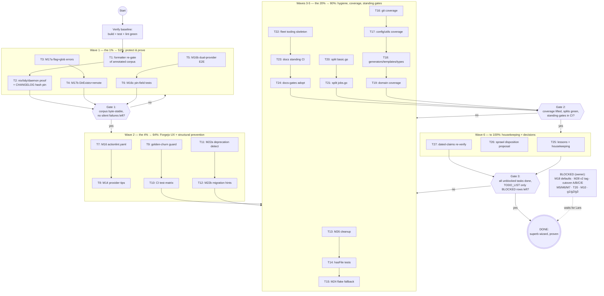

# SUPERB Wave-6 Hardening & Proof — Pareto Execution Plan

**Date:** 2026-11-07 08:51
**Status:** PLANNED — awaiting execution
**Sources:** `TODO_LIST.md` (20 verified rows, 2026-11-07), status report `docs/status/2026-11-07_08-46_docs-health-audit-sweep-status.md` §f (50 items), plan `docs/planning/2026-08-16_18-45_SUPERB-WIZARD-MODERNIZATION.md` Wave-6 remainder (M17-M28, all routed to TODO_LIST)
**Freshness:** every task verified open against code on 2026-11-07 (docs-health sweep same day; TODO_LIST evidence columns carry `file:line`)
**Goal owner:** Lars — a wizard whose output is machine-proven correct and whose docs never lie

---

## 0. Context — where the project stands

The v2.17 modernization (Aug) and the Forgejo provider (Oct) made the wizard's core promise true: generated output passes `goreleaser check` with zero deprecations, proven by E2E + goldens. The docs-health sweep (today, commit `2fcc8a2`) made the docs trustworthy: 18 stale reports annotated + archived, living docs rebuilt on verified evidence.

What remains is **hardening with proof**: close the correctness warts the waves left (silent error discards, untested pins, missing dual-provider E2E), make `validate` actually earn its name, lift coverage on the packages that carry the product, and lock the docs corpus behind standing gates. Owner-gated items (Forgejo cutover phases, v2 tag, personal defaults) stay BLOCKED — they are listed, not scheduled.

**Anti-Verschlimmbesserung guardrails:**

1. Don't touch the template rendering path without a golden/E2E proof in the same task.
2. Don't rename public identifiers while wiring (M17/M22 move call sites, not names).
3. Delete-then-build: after any extraction, `go build` FIRST, then fix callers.
4. No behavior change without a test proving the old behavior wrong.
5. One logical change per commit; full gate green before each commit.
6. Respect the auto-commit daemon; never leave half-broken trees.
7. The archived corpus is closed history — the only permitted touch is the T1 formatter re-gate.

---

## 1. Pareto Breakdown

### The 1% that delivers 51% — _protect the corpus, kill the silent failures, prove the pins_

- **T1 Formatter re-gate** of the annotated corpus (annotate → check-rows → **format** → check-rows AGAIN — the sweep's one unfinished canon step; without it, 1,100 verdicts are one format pass from damage).
- **T3+T4 M17 error-discarding fixes** — the generation path currently swallows flag/glob/FS/git errors; this is the last "silently wrong output" class in the product.
- **T5+T6 M16b/M16c** — dual-provider output is shipped but only forgejo+github goldens are check-proven, and the pins (BuildFlow rev, goreleaser v2.17.1) that the whole Forgejo story rests on have zero tamper tests.

> ~4.5h of the ~21h plan. Without these, the product's two core claims ("proven correct", "docs don't lie") are both overstated.

### The 4% that delivers 64% — _complete the Forgejo UX, make validate real, structurally prevent regressions_

- **T7 M16** `.forgejo/actionlint.yaml` generation (retires gotcha 17's `<(...)` hack).
- **T8 M14** provider-aware success tips (today `generate --ci-provider forgejo` points users at `.github/workflows` — actively wrong UX).
- **T9+T10** golden-churn guard + CI test-matrix (generate × 4 providers, `go_1_27 ≥ go.mod` guard, `nix flake check` in CI): deprecations and goldens churn become structurally impossible to reintroduce.
- **T11+T12 M22** `validate` learns deprecated-key detection with before→after migration hints — the command finally does what its name promises.

### The 20% that delivers 80% — _hygiene, coverage, standing gates_

- **T13-T15** M26 cleanup, `hasFile` tests (the function whose 2026-06 breakage killed the build still has zero direct tests), flake cache fallback.
- **T16-T19** coverage lifts in dependency order: git → config/utils → generators/templates/types → domain (the model everything consumes).
- **T20+T21** oversized-file splits (top 2: `basic.go` 767, `jobs.go` 685) — scoped, extract-two, stop.
- **T22** fleet tooling in-repo parts (flip-batch wrapper + preflight generator skeleton).
- **T23+T24** standing docs gates (formatter+links+counts in CI; docs-gates adoption).
- **T27** dated-claims re-verification pass.

### The other 20% (to reach 100%)

- **T25** lessons persistence + doc housekeeping (ROADMAP prune date, DOMAIN_LANGUAGE examples, gotcha 11 slim).
- **T26** root sprawl + `github_issues/` disposition **proposal** (execution needs the owner call — see Blocked).
- **BLOCKED tier** (owner-gated, listed in TODO_LIST): M18 personal defaults, M28 v2 tag, cutover phases A/B/C/E + M5/M6/M7, T20 decommission, M10 mirror sweep, g1/g2/g3 answers.

---

## 2. Comprehensive Plan — Medium granularity (27 tasks, 30–100 min)

Sorted by importance → impact → customer value. "Src" = where the task came from.

| #   | Wave | Task                                                                                                                                                           | Imp | Eff | Cust. value                                  | Src       |
| --- | ---- | -------------------------------------------------------------------------------------------------------------------------------------------------------------- | --- | --- | -------------------------------------------- | --------- |
| T1  | 1    | Formatter pass over annotated corpus + living docs, then re-run `check-rows --strict`/`bare-rows`/`prose-items`; repair any damage                             | 10  | 30m | The 1,100 verdicts survive the next format   | §f1       |
| T2  | 1    | Post-sweep proof: `nix flake check`, `go mod tidy` clean, daemon end-state verify, pin sweep hash `2fcc8a2` into CHANGELOG                                     | 9   | 30m | Repo state provably clean                    | §f2/4     |
| T3  | 1    | M17a: `flags.go` explicit flag-error handling + `init.go:248` glob error path + tests                                                                          | 9   | 60m | No more silent generation failures           | TODO H1   |
| T4  | 1    | M17b: `validate_main.go` DirExists error distinction + `parseGitHubRemote` real empty/warn + tests + goldens                                                   | 9   | 60m | No placeholder `owner/repo` leakage          | TODO H1   |
| T5  | 1    | M16b: dual-provider `goreleaser check` E2E (extend golden/E2E harness to the dual variant)                                                                     | 9   | 45m | All three providers check-proven             | TODO H2   |
| T6  | 1    | M16c: `NewForgejoWorkflowsTemplateData` pin-field unit tests (BuildFlow rev + goreleaser version, tamper detection)                                            | 9   | 60m | Pins can never float silently                | TODO H3   |
| T7  | 2    | M16: generate `.forgejo/actionlint.yaml` (native label) + golden; retire gotcha 17's `<(...)` hack                                                             | 8   | 45m | Generated workflows lint out of the box      | TODO H4   |
| T8  | 2    | M14: provider-aware CLI success tips (forgejo/dual → `.forgejo/workflows/…`)                                                                                   | 8   | 30m | Correct guidance for every provider          | TODO H5   |
| T9  | 2    | Golden-churn guard: CI asserts `testdata/` stays clean on `-update-golden` runs                                                                                | 8   | 30m | Golden drift becomes a red build             | TODO H8   |
| T10 | 2    | CI test-matrix: generate × {github,forgejo,dual,none} + `go_1_27 ≥ go.mod` guard + `nix flake check` in CI                                                     | 8   | 60m | Provider regressions structurally impossible | TODO H7   |
| T11 | 3    | M22a: `validate` parses target `.goreleaser.yaml`, detects deprecated keys (`dockers`, `brews`, `format_overrides.format`, `release.mode`, per-docker `retry`) | 8   | 60m | Users can self-diagnose old configs          | TODO H6   |
| T12 | 3    | M22b: exact before→after migration snippets + deprecation links in output + tests + README docs                                                                | 8   | 45m | Self-migration path                          | TODO H6   |
| T13 | 4    | M26: init.go `printCommandHeader()` consistency; remove `OrEmpty()` (verify zero callers); triage stale `nlreturn`/`wsl` warnings                              | 6   | 30m | Consistency + less lint noise                | TODO M4   |
| T14 | 4    | `hasFile` table tests + neighbors in `internal/utils` (the 2026-06 build-killer gets proof)                                                                    | 6   | 30m | The build-killer can never recur silently    | TODO M5   |
| T15 | 4    | M24: flake.nix shellHook fallback to local cache dirs when `/mnt/buildcache` dead + proof                                                                      | 6   | 30m | DevShell never breaks again                  | TODO M3   |
| T16 | 4    | Coverage wave 1: `internal/git` — `ParseGitHubURL` table (https/ssh/port/none) + version helpers                                                               | 6   | 60m | Critical parsing path protected              | TODO M1   |
| T17 | 4    | Coverage wave 1b: `internal/config` Manager precedence + `internal/utils` remainder                                                                            | 6   | 60m | Config layer protected                       | TODO M1   |
| T18 | 4    | Coverage wave 2: generators render tests (incl. unwired `homebrew.go`), templates parse/render, types mapping                                                  | 6   | 60m | The product surface tested                   | TODO M1   |
| T19 | 4    | M21: domain coverage lift — enum `IsValid` tables, `SafeProjectConfig.Validate()` error paths, `ApplyDefaults()`/`Clone()` invariants → ≥40% (stretch 60%)     | 7   | 90m | The heart of the model protected             | TODO M2   |
| T20 | 5    | Split `internal/validation/basic.go` (767): scope → extract docker-registry validators → gates                                                                 | 5   | 60m | Maintainability debt starts shrinking        | TODO M6   |
| T21 | 5    | Split `cmd/goreleaser-wizard/jobs.go` (685): scope → extract factory + git-utility helpers → gates                                                             | 5   | 60m | Second-largest file shrinks                  | TODO M6   |
| T22 | 5    | Fleet tooling in-repo: `forgejo-flip-batch@` wrapper unit + M12 wave-1 preflight generator skeleton                                                            | 5   | 45m | Wave-1 flip readiness                        | §f25/34   |
| T23 | 5    | Standing docs CI: formatter check + link check + FEATURES counts test wired into `ci.yml`                                                                      | 6   | 30m | Docs rot structurally blocked                | §f9/10    |
| T24 | 5    | docs-gates adoption: run battery over repo, seed `.docs-gates.json`, wire `scripts/docs-gates.sh`                                                              | 5   | 30m | Freshness/routing/cadence mechanized         | §f3       |
| T25 | 6    | Housekeeping: 3 lessons → crush-config `references/lessons.md` (commit), ROADMAP prune date, DOMAIN_LANGUAGE examples, slim gotcha 11                          | 4   | 30m | Memory + docs stay current                   | §f7/47-49 |
| T26 | 6    | Root sprawl + `github_issues/` disposition **proposal** (inventory + classification; execution awaits owner call)                                              | 4   | 30m | Decision-ready cleanup                       | §f27/41   |
| T27 | 6    | Dated-claims re-verify: local snapshot `goreleaser check` on own config → re-date FEATURES claim; scan living docs for stale dated claims                      | 5   | 45m | External/dated claims stay true              | §f43      |

**Total: ~21h of focused work across 27 tasks.** BLOCKED tier (not scheduled): M18 flags+defaults, M28 v2 release, cutover A/B/C/E + M5/M6/M7, T20, M10, g1/g2/g3 — all live in TODO_LIST with blockers named.

---

## 3. Fine-Granularity Plan — ≤12 min each (98 tasks, ALL TODOs covered)

### Wave 1 — Protect & prove (the 1% → 51%)

| #   | Task                                                                                    | ≤12m | Verification                  |
| --- | --------------------------------------------------------------------------------------- | ---- | ----------------------------- |
| F1  | Run repo formatter over `docs/status/archived/` + `docs/research/archived/` + root docs | 12   | diff shows only re-wraps      |
| F2  | `check-rows --strict` + `bare-rows` + `prose-items` over the archived set (post-format) | 12   | 18/18 complete, 0 bare        |
| F3  | Repair any formatter damage found (`unwrap`/`repair-partial`/`repair-mangle`)           | 12   | gates green again             |
| F4  | Re-run formatter on repaired files → confirm byte-stable (canon proof)                  | 12   | second format pass = no-op    |
| F5  | `nix flake check`                                                                       | 12   | all checks pass               |
| F6  | `go mod tidy` + diff inspect (this session's go.sum additions)                          | 12   | tidy no-op or intentional     |
| F7  | Verify daemon end-state: `git log`/`ls-files` show renames + manifests committed        | 12   | tree matches 2fcc8a2 intent   |
| F8  | Pin sweep hash `2fcc8a2` into CHANGELOG Unreleased docs entry                           | 12   | CHANGELOG diff                |
| F9  | Read `flags.go` current shape; decide handle-vs-bug-panic per helper                    | 12   | decision recorded in commit   |
| F10 | Implement explicit flag-error handling (keep names, change internals)                   | 12   | builds                        |
| F11 | Migrate all call sites of `getBoolFlag`/`getStringFlag`                                 | 12   | compiles, no discards         |
| F12 | `init.go:248`: handle `filepath.Glob` error (don't conflate with "no matches")          | 12   | error path exercised          |
| F13 | Test: flag-error + glob-error paths (table)                                             | 12   | green                         |
| F14 | Full gate: build + test + lint on M17a                                                  | 12   | all green                     |
| F15 | `validate_main.go:167`: distinguish DirExists error from "missing"                      | 12   | error path tested             |
| F16 | `parseGitHubRemote`: return empty + warning instead of `"owner"/"repo"` placeholders    | 12   | no placeholder leakage        |
| F17 | Warning-on-placeholder path: assert the warning prints (placeholder owners in types)    | 12   | test green                    |
| F18 | Regenerate goldens if outputs changed; `git status testdata/` clean check               | 12   | goldens green                 |
| F19 | Full gate on M17b (build + test + lint + arch-lint)                                     | 12   | all green                     |
| F20 | Read `golden_test.go`/`e2e_test.go` harness; map dual-variant insertion point           | 12   | plan noted in test file       |
| F21 | Add dual-variant generation + `goreleaser check` E2E case                               | 12   | case green (or graceful skip) |
| F22 | Prove skip-graceful path without goreleaser binary (env guard)                          | 12   | skips cleanly                 |
| F23 | Read `NewForgejoWorkflowsTemplateData` + pin constants                                  | 12   | fields inventoried            |
| F24 | Table test: BuildFlow rev + goreleaser version render into both workflows               | 12   | green                         |
| F25 | Tamper test: wrong pin → test fails (guards against float)                              | 12   | red-then-green proof          |
| F26 | Wire pin tests into `go test ./...` normal run                                          | 12   | suite green                   |

### Wave 2 — Forgejo UX + structural regression prevention (the 4% → 64%)

| #   | Task                                                                                                                                | ≤12m | Verification                    |
| --- | ----------------------------------------------------------------------------------------------------------------------------------- | ---- | ------------------------------- |
| F27 | Draft `.forgejo/actionlint.yaml` content (self-hosted `native` label)                                                               | 12   | YAML valid                      |
| F28 | Add template constant + generator wiring (`ForgejoWorkflowsGenerator` writes it)                                                    | 12   | builds                          |
| F29 | Golden for `actionlint.yaml`                                                                                                        | 12   | golden green                    |
| F30 | E2E: drop the `<(...)` config hack; update AGENTS gotcha 17 to "generated"                                                          | 12   | E2E green without hack          |
| F31 | Locate success-tip block(s) in `generate.go`/`init.go`                                                                              | 12   | sites inventoried               |
| F32 | Provider-aware tip text (forgejo/dual → `.forgejo/workflows/…`; none → silent)                                                      | 12   | renders both ways               |
| F33 | Test tips for all four providers                                                                                                    | 12   | green                           |
| F34 | Script: run `-update-golden`, then assert `git status testdata/` clean                                                              | 12   | script exits correctly          |
| F35 | Add golden-churn step to `ci.yml`                                                                                                   | 12   | workflow YAML valid             |
| F36 | Local proof of the churn guard (tamper testdata → red; restore → green)                                                             | 12   | red/green demo                  |
| F37 | CI matrix job: generate × {github,forgejo,dual,none} with per-provider assertions                                                   | 12   | job green locally via act/parse |
| F38 | Guard test: flake's `go_1_27` ≥ go.mod's go directive                                                                               | 12   | test green                      |
| F39 | CI job: `nix flake check` (or document why not runnable on CI runners)                                                              | 12   | job or documented decision      |
| F40 | Lint ci.yml + actionlint the workflows                                                                                              | 12   | clean                           |
| F41 | `validate`: locate config-parse entry; add `.goreleaser.yaml` YAML parse step                                                       | 12   | parses sample configs           |
| F42 | Encode deprecation key list (`dockers`, `docker_manifests`, `brews`, `format_overrides.format`, `release.mode`, per-docker `retry`) | 12   | table constant                  |
| F43 | Detection walk + structured findings (file:line:key)                                                                                | 12   | detects seeded sample           |
| F44 | Tests: deprecated vs clean config fixtures                                                                                          | 12   | green                           |
| F45 | Before→after snippet table per deprecation (from docs/goreleaser-guide.md facts)                                                    | 12   | snippets accurate               |
| F46 | Output formatting via `displayError` What/Why/Fix/Escape pattern                                                                    | 12   | reviewed output                 |
| F47 | Output tests (deprecated sample → hints present)                                                                                    | 12   | green                           |
| F48 | README `validate` section: document deprecation detection                                                                           | 12   | docs diff                       |

### Wave 3/4 — Hygiene, coverage, standing gates (the 20% → 80%)

| #   | Task                                                                                                                     | ≤12m | Verification                 |
| --- | ------------------------------------------------------------------------------------------------------------------------ | ---- | ---------------------------- |
| F49 | init.go: replace inline `titleStyle.Render` with `printCommandHeader()`                                                  | 12   | output identical             |
| F50 | `grep -rn "OrEmpty"` → confirm zero callers → remove                                                                     | 12   | build passes                 |
| F51 | Triage `nlreturn`/`wsl` LSP warnings vs real golangci output; record verdict                                             | 12   | notes in commit/AGENTS       |
| F52 | `hasFile` table tests (hit/miss/subdir cases)                                                                            | 12   | green                        |
| F53 | `internal/utils` neighbor quick tests (recommendations paths)                                                            | 12   | green                        |
| F54 | flake.nix shellHook: fallback exports when `/mnt/buildcache` missing                                                     | 12   | shellHook syntax ok          |
| F55 | Simulate missing mount (env override) → devshell works                                                                   | 12   | Go tools run via /tmp caches |
| F56 | `nix flake check` with fallback in place                                                                                 | 12   | all pass                     |
| F57 | `internal/git`: `ParseGitHubURL` table (https/ssh/ssh-with-port/none)                                                    | 12   | green                        |
| F58 | `internal/git`: `GetMajorVersion`/`IncPatchVersion`/`stripVersionPrefix` tests                                           | 12   | green                        |
| F59 | Measure `internal/git` coverage delta                                                                                    | 12   | number recorded              |
| F60 | `internal/config`: Manager load precedence tests (defaults < file < env < flags)                                         | 12   | green                        |
| F61 | `internal/utils` remaining uncovered functions                                                                           | 12   | green                        |
| F62 | Coverage measurement wave 1b                                                                                             | 12   | number recorded              |
| F63 | Generators render tests incl. unwired `homebrew.go` (render-only proof)                                                  | 12   | green                        |
| F64 | Templates: all embedded templates parse + render with sample data                                                        | 12   | green                        |
| F65 | Types: `NewGoReleaserTemplateData`/`NewGitHubActionsTemplateData` mapping tests                                          | 12   | green                        |
| F66 | Coverage measurement wave 2                                                                                              | 12   | number recorded              |
| F67 | Domain: enum `IsValid` table tests (all enums, valid + invalid)                                                          | 12   | green                        |
| F68 | Domain: `SafeProjectConfig.Validate()` table (each error path)                                                           | 12   | green                        |
| F69 | Domain: `ApplyDefaults()`/`Clone()` invariants                                                                           | 12   | green                        |
| F70 | Coverage report: domain % vs 40/60% targets; record                                                                      | 12   | number recorded              |
| F71 | Scope split of `basic.go` (function → target-file map written as comment/notes)                                          | 12   | map committed                |
| F72 | Extract docker-registry validators → `basic_registry.go`                                                                 | 12   | builds                       |
| F73 | Fix imports/callers; `go build` FIRST then fix (guardrail 3)                                                             | 12   | compiles clean               |
| F74 | Gate: build + test + lint + arch-lint on the split                                                                       | 12   | all green                    |
| F75 | Coverage delta of validation package post-split (no coverage lost)                                                       | 12   | number recorded              |
| F76 | Scope split of `jobs.go` (job structs vs factory vs helpers map)                                                         | 12   | map committed                |
| F77 | Extract job factory → `job_factory.go`                                                                                   | 12   | builds                       |
| F78 | Extract git-utility helpers → `git_helpers.go`                                                                           | 12   | builds                       |
| F79 | Gate: build + test + lint + arch-lint on the split                                                                       | 12   | all green                    |
| F80 | Read existing flip scripts (`forgejo-post-flip-verify`, branch-protect) for interface                                    | 12   | interface inventoried        |
| F81 | `forgejo-flip-batch@` wrapper unit skeleton (one sudo per wave)                                                          | 12   | skeleton + fixture           |
| F82 | M12 preflight generator skeleton + one fixture scenario                                                                  | 12   | skeleton green               |
| F83 | Docs CI job: markdown link check + formatter check over root + docs/                                                     | 12   | job green                    |
| F84 | FEATURES counts test stub: parse status table, assert totals match rows                                                  | 12   | green                        |
| F85 | Wire docs job into `ci.yml`                                                                                              | 12   | workflow valid               |
| F86 | Run `docs-gates run .` over the repo; triage findings                                                                    | 12   | battery report               |
| F87 | Seed `.docs-gates.json` with repo-specific thresholds (if needed)                                                        | 12   | config valid                 |
| F88 | `scripts/docs-gates.sh` composition (dprint first, battery, repo gates) + wire                                           | 12   | script runs                  |
| F89 | Commit 3 lessons to crush-config `references/lessons.md` (single-specfile repair, checkbox text-keys, subagent throttle) | 12   | committed there              |
| F90 | ROADMAP: add quarterly-prune date line (next ~2027-02)                                                                   | 12   | diff                         |
| F91 | DOMAIN_LANGUAGE: fill Commands/Events example rows with real wizard commands/events                                      | 12   | diff                         |
| F92 | AGENTS gotcha 11: slim to "obsolete, kept for history" (everyone on 1.27)                                                | 12   | diff                         |
| F93 | Inventory 17 root `.md` files → classification table (living / archive / delete-candidate)                               | 12   | table written                |
| F94 | Inventory `github_issues/` (25 files) → classification                                                                   | 12   | table written                |
| F95 | Disposition proposal doc for owner (execution awaits g3 answer)                                                          | 12   | proposal committed           |
| F96 | Local snapshot `goreleaser check` on own config (if binary present) → capture output                                     | 12   | exit 0 + zero deprecations   |
| F97 | Re-date FEATURES Docker claim with the new verification date                                                             | 12   | diff                         |
| F98 | Scan living docs for other dated claims; stamp or refresh each                                                           | 12   | list + diffs                 |

**Total: 98 fine tasks.** Blocked tier (owner-gated; NOT expanded — they cannot be executed): M18 flags+defaults, M28 v2 release, cutover phases A/B/C/E + M5/M6/M7 live proofs, T20 decommission, M10 mirror sweep, g1/g2/g3 answers, root-sprawl execution (F93-F95 prepare it).

---

## 4. Execution Graph (mermaid.js)

**Critical path:** T1 → T3 → T4 → T5 → T6 → Gate 1 → T10 → T12 → Gate 2 → T19 → T21 → T24 → T27 → Gate 3.

---

## 5. Verification Strategy (gates, not vibes)

| Gate                       | Command / check                                                  | Must be                   |
| -------------------------- | ---------------------------------------------------------------- | ------------------------- |
| Every task                 | `go build ./...`                                                 | exit 0                    |
| Every task end             | `go test ./...`                                                  | all green                 |
| Template/generator changes | render + `goreleaser check`                                      | exit 0, zero deprecations |
| Splits (T20/T21)           | build FIRST, then callers; coverage must not drop                | cascade caught early      |
| Docs tasks                 | `check-rows --strict` + `bare-rows` + link check                 | all green                 |
| Docs coverage claims       | counts derived from repo, not hand-maintained                    | test-verified             |
| Pre-push                   | full gate: build + test + lint + arch-lint (+ `nix flake check`) | all green                 |

---

## 6. Errata & corrections vs prior plans

- 2026-08-16 plan's Wave-6 items M17-M27 are **routed, not re-derived** — this plan's T3-T19, T25-T27 and the BLOCKED tier are their direct descendants (M-numbers preserved). Nothing re-dispatched.
- TODO_LIST rows carry `file:line` evidence verified 2026-11-07; anything found already-done during execution gets closed inline (→ CHANGELOG) per docs-health, not silently skipped.
- §f items 44-46, 49-50 of the 08-46 report are housekeeping-grade and folded into T25/T27; §f8 (bullet strikes in archived corpus) deliberately NOT scheduled — the corpus is closed history, gate coverage is sufficient.
